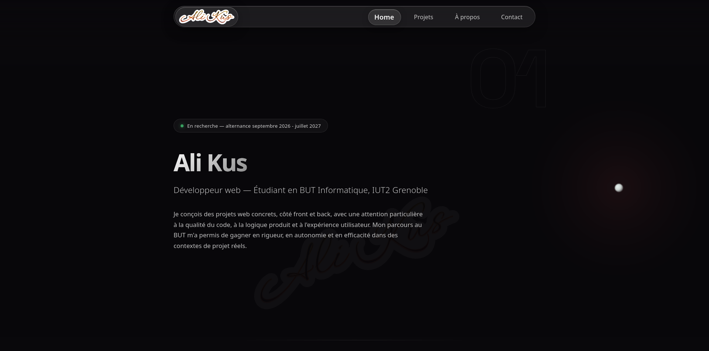

# Portfolio — Ali Kus

Portfolio personnel d'**Ali Kus**, développeur web full-stack (BUT Informatique, IUT2 Grenoble).
Une page unique, direction artistique sombre et cinématique, animations sur mesure.

🔗 **En ligne : [alikus.fr](https://alikus.fr)**



## ✨ Aperçu

- **Intro animée** — frappe naturelle et reveal du logo, jouée une seule fois par session (`sessionStorage`).
- **Carousel de projets** — six projets (universitaires, personnels, professionnels), rotation auto, pause au survol, modale détaillée et démos interactives à hotspots.
- **Direction artistique** — fond sombre, signature dorée révélée dans le faisceau du curseur, effet « finale » chaud au niveau de la section contact (peak-end rule).
- **Accessibilité** — navigation clavier, `aria-*`, respect de `prefers-reduced-motion`.
- **Responsive** mobile-first et métadonnées Open Graph / Twitter pour le partage.

## 🛠️ Stack

- [React 19](https://react.dev/)
- [Vite 7](https://vite.dev/)
- [Framer Motion](https://www.framer.com/motion/) pour les animations
- ESLint pour la qualité du code

## 🚀 Démarrage

```bash
npm install      # installe les dépendances
npm run dev      # serveur de dev (Vite, HMR)
npm run build    # build de production → dist/
npm run preview  # prévisualise le build
npm run lint     # vérifie le code
```

## 📁 Structure

```
src/
├── App.jsx                  # page unique : hero, projets, à propos, contact
├── Navbar.jsx
├── components/
│   ├── IntroAnimation.jsx   # intro frappe + reveal logo
│   ├── ProjectsSection.jsx  # carousel + modale projets
│   ├── ProjectStory.jsx     # démos interactives à hotspots
│   ├── CursorFx.jsx         # effets liés au curseur
│   └── TechBackdrop.jsx     # fond animé du footer
├── utils/smoothScroll.js
└── assets/
public/                      # favicons, logo, CV PDF
```

## 📫 Contact

- Email — ali.kus@outlook.fr
- LinkedIn — [ali-kus-fr](https://www.linkedin.com/in/ali-kus-fr/)
- GitHub — [@ali-kus](https://github.com/ali-kus)
