<!-- ENGLISH version. Linked from the 🇬🇧 flag in every other file. -->

  
  
  
  

  

---

### 👋 Hi, I'm Ali

A **full-stack developer** student, currently **open to internships & junior roles**.
I like building clean, useful web products — and I learn fast.

- 🌱 Currently sharpening **React, Next.js, Supabase** and automated testing
- 🤖 Strongly interested in **AI applied to software development**
- 🎯 Goal: join a team where I can ship real things and grow
- ⚡ Fun fact: I enjoy optimizing code more than writing it

---

### 🛠️ Stack & tools

  
  
  
  
  
  
  
  
  
  

---

### 📊 My GitHub activity

  
  

---

### 📫 Reach me

  
  
  

⭐️ Feel free to explore my repositories and connect.
